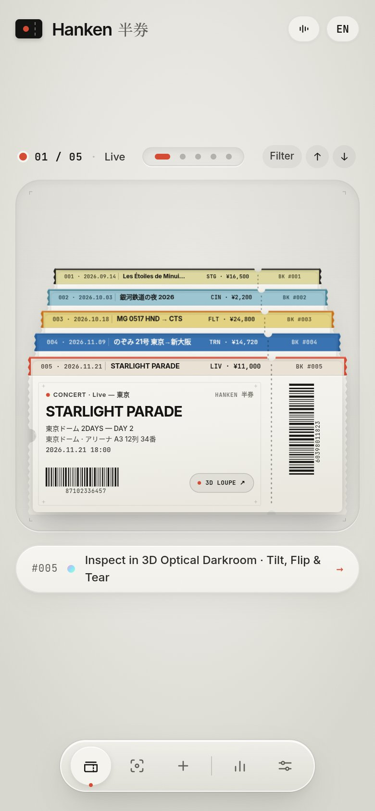

# Hanken 半券

[简体中文](README.zh-CN.md) | **English** | [日本語](README.md)

An archive for plane, train, cinema and concert tickets. Ticket text is parsed on the device into fields such as date, seat and price, and the ticket is redrawn in WebGL: tilt it and the sheen moves, flip it over, or tear the stub off along the perforation.

> In development. The local features work in the browser; the native app (OCR), cloud sync and cloud recognition are not built yet, and nothing is deployed.

<p></p>
<p>
  
  
</p>

## What works now

### Renderer (`packages/renderer`)

- 8 templates: concert (holographic), JR magnetic ticket, boarding pass, thermal cinema ticket, theatre, sports, exhibition, generic stub.
- 6 materials: wove paper, thermal paper, cardstock, holographic foil, brushed gold foil, magnetic stock.
- Tilt with the pointer or the gyroscope and the reflections move. Tickets can be flipped, torn along the perforation and punched, and the paper yellows with age.
- Slower devices drop to a lower quality tier automatically, falling back to 2D drawing if needed.
- One shader covers every material and both sides. Lighting is computed analytically, so no HDRI maps are needed.

### Recognition (`packages/shared`)

Plain TypeScript with no platform dependencies.

- Classifies ticket types with Chinese, Japanese, English and Korean keywords, with dedicated rules for JR, boarding passes, cinemas and events.
- Dates in Reiwa era notation, English and Korean, and tickets with no year printed (inferred from when the photo was taken). It also extracts times, seats, prices (JPY and CNY), routes, venues and entry order numbers.
- Parses boarding-pass barcodes (BCBP) without outputting the passenger name or booking reference. Lines with order numbers, names or membership numbers are removed before anything is sent to the cloud.
- On 9 synthetic test tickets, every field is extracted correctly. Six finish on the device; the other three fall short on title confidence and go to cloud text recognition, as designed.

### App (`apps/app`)

- Archive: filter by ticket type, year, tag or keyword, grouped by year and month.
- Scan: load a photo and drag the four corners to correct perspective. The review screen highlights fields with confidence below 0.8.
- Detail: 3D view with three backdrops, photos from the day, and an 1800×1200 share poster in three styles, with the barcode and exact seat hidden by default.
- Edit: a form for each of the 8 ticket types, with a live preview.
- Yearly recap and a map of places visited, with flight distances computed along great circles.
- Settings: Chinese, Japanese or English interface, sound effects synthesized with Web Audio, render quality, JSON backup and import, and a 30-day trash.
- Data is stored on the device in IndexedDB (Dexie) and works offline. A few fictional sample tickets are added on first launch.

The web version has no native OCR, so the scan screen takes its text from 4 built-in samples (JR Shinkansen, a BCBP boarding pass, a TOHO cinema ticket and a Tokyo Dome concert), or from text you type or edit.

<p align="center"></p>

## Not built yet

- Capacitor 7 native shell and OCR plugin (Vision on iOS, ML Kit on Android).
- Supabase backend: tables, RLS, sync, and an Edge Function that calls Gemini for recognition. The prompts, output schema and result merging are written; the HTTP call is not.
- More recognition test data from real tickets.
- Renderer: bundled font subsets, self-hosted detect-gpu benchmark data, stamps, and screenshot comparison tests.

## Tech stack

pnpm workspace and TypeScript. The app uses React, TanStack Router, Tailwind CSS, Dexie, Zod, Zustand, i18next and Motion; the renderer uses three.js and React Three Fiber. Tests run on Vitest, and Biome handles formatting and linting.

## Running locally

Requires Node.js 22 or later.

```bash
npx -y pnpm@10 install
npx -y pnpm@10 dev            # app at http://localhost:5173
npx -y pnpm@10 dev:renderer   # renderer demo at http://localhost:5174
npx -y pnpm@10 test           # Vitest
npx -y pnpm@10 typecheck      # type check
npx -y pnpm@10 lint           # Biome
```

URL parameters fix the demo page's view: `/?ticket=0&tiltX=0.3&tiltY=0.2&quality=high&flipped=0&ui=0` (`ticket`: 0 concert, 1 JR, 2 boarding pass; `ui=0` hides the panel).

## Documentation (in Chinese)

| File | Contents |
| --- | --- |
| [docs/01-requirements.md](docs/01-requirements.md) | Requirements: background, competitors, personas, functional and non-functional requirements, business model, risks |
| [docs/02-architecture.md](docs/02-architecture.md) | Architecture: technology choices, rendering engine, scanning and recognition, data model, sync, deployment, cost |
| [docs/03-development.md](docs/03-development.md) | Development: repository layout, coding standards, testing, releases, milestones |
| [docs/04-handoff.md](docs/04-handoff.md) | Handoff: finished modules, public interfaces, order of the remaining work |

## About the screenshots

The images in `docs/screenshots/` are taken by the "README 截图" GitHub Actions workflow, which opens the demo page and the app in headless Chrome with software WebGL. To refresh them, run the workflow by hand from the Actions page.
