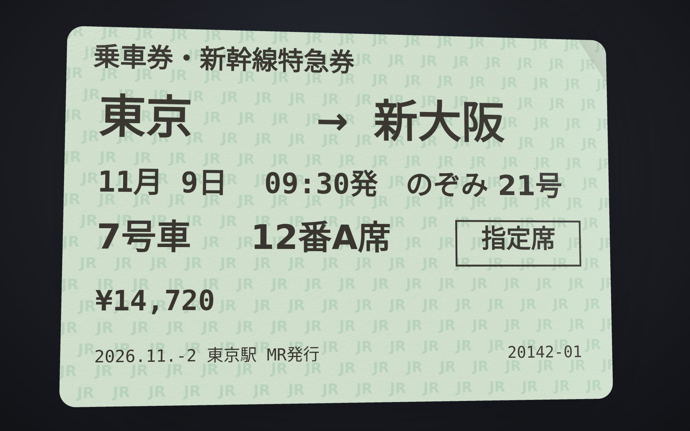
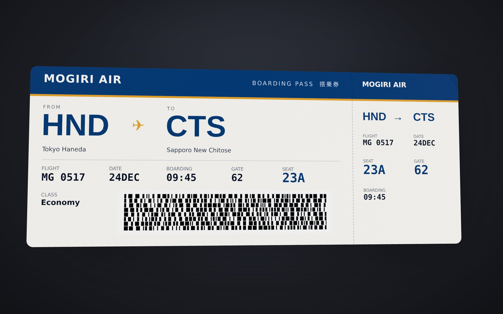
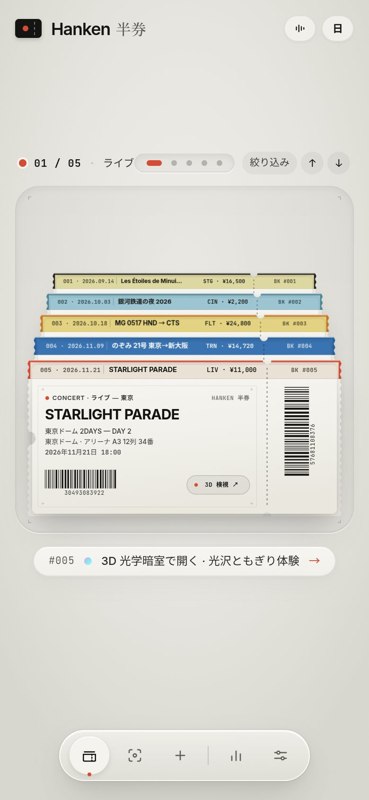

# 半券 Hanken

[简体中文](README.zh-CN.md) | [English](README.en.md) | **日本語**

航空券、乗車券、映画、ライブのチケットを残しておくためのアーカイブアプリです。券面の文字を端末内で日付、座席、金額などの項目に読み分け、WebGLで一枚のチケットとして描き直します。傾けると光沢が動き、裏返したり、ミシン目から半券をもぎったりできます。

> 開発中です。ブラウザー上のローカル機能は動きますが、ネイティブアプリ（OCR）、クラウド同期、クラウド認識はまだで、公開もしていません。

<p></p>
<p>
  
  
</p>

## できること

### レンダラー（`packages/renderer`）

- 8種類のテンプレート：ライブ（ホログラム箔）、JR磁気券、搭乗券、感熱紙の映画チケット、劇場、スポーツ、展覧会、汎用。
- 6種類の素材：上質紙、感熱紙、厚紙カード、ホログラム箔、ヘアライン金箔、磁気券。
- ポインターやジャイロで傾けると、光の映り込みが動きます。裏返し、ミシン目に沿ったもぎり、パンチ穴、紙の黄ばみにも対応しています。
- 性能の低い端末では自動で画質を下げ、必要なら2D描画に切り替えます。
- シェーダーは1本で全素材と表裏を扱います。照明は計算で作っているので、HDRI画像は使っていません。

### 認識（`packages/shared`）

プラットフォームに依存しない、純粋なTypeScriptです。

- 中日英韓のキーワードで券種を判定し、JR、搭乗券、映画、イベントには専用のルールがあります。
- 日付は令和表記、英語、韓国語、年の書かれていない券面（撮影日時から推定）に対応します。時刻、座席、金額（円・人民元）、区間、会場、整理番号も取り出します。
- 搭乗券のバーコード（BCBP）を解析します。氏名と予約番号は出力しません。クラウドに送る前には、注文番号、氏名、会員番号などの行を取り除きます。
- 合成した9枚のテスト用券面では、全項目を正しく抽出できています。6枚は端末内で完結し、残る3枚はタイトルの確信度が足りないため、設計どおりクラウドのテキスト認識に回ります。

### アプリ（`apps/app`）

- 一覧：券種、年、タグ、キーワードで絞り込み、年月ごとに並べます。
- スキャン：写真を読み込み、四隅をドラッグして台形補正します。確認画面では、確信度が0.8未満の項目を強調表示します。
- 詳細：3D表示（背景は3種類）。当日の写真を添えられます。1800×1200の共有用ポスターを3種類の台紙で書き出せ、バーコードと座席番号は初期設定で隠します。
- 編集：8券種それぞれのフォームと、入力に合わせて変わるプレビュー。
- 年ごとのまとめと、足あと地図（航路は大圏距離で計算）。
- 設定：中国語・日本語・英語の表示切り替え、効果音（Web Audioで合成）、描画品質、JSONでのバックアップと読み込み、30日間のごみ箱。
- データは端末内のIndexedDB（Dexie）に保存し、オフラインで動きます。初回起動時には架空のサンプルチケットが数枚入ります。

ブラウザー版にはネイティブOCRがないため、スキャン画面の文字は内蔵の4つのサンプル（JR新幹線、BCBP搭乗券、TOHOの映画券、東京ドームのライブ）から選ぶか、自分で入力・修正します。

<p align="center"></p>

## まだやっていないこと

- Capacitor 7のネイティブアプリとOCRプラグイン（iOSはVision、AndroidはML Kit）。
- Supabaseのバックエンド：テーブル、RLS、同期、Geminiを呼ぶ認識用のEdge Function。プロンプト、出力スキーマ、結果のマージは実装済みで、HTTP呼び出しが未実装です。
- 実際の券面を使った認識テストデータの追加。
- レンダラー：フォントのサブセット同梱、detect-gpuのベンチマークデータの自前ホスト、スタンプ、スクリーンショット比較テスト。

## 技術スタック

pnpmワークスペース、TypeScript。アプリはReact、TanStack Router、Tailwind CSS、Dexie、Zod、Zustand、i18next、Motion、レンダラーはthree.jsとReact Three Fiberです。テストはVitest、フォーマットと静的解析はBiomeを使っています。

## ローカルで動かす

Node.js 22以上が必要です。

```bash
npx -y pnpm@10 install
npx -y pnpm@10 dev            # アプリ http://localhost:5173
npx -y pnpm@10 dev:renderer   # レンダラーのデモページ http://localhost:5174
npx -y pnpm@10 test           # Vitest
npx -y pnpm@10 typecheck      # 型チェック
npx -y pnpm@10 lint           # Biome
```

デモページはURLパラメーターで表示を固定できます：`/?ticket=0&tiltX=0.3&tiltY=0.2&quality=high&flipped=0&ui=0`（`ticket`は0がライブ、1がJR、2が搭乗券。`ui=0`でパネルを隠します）。

## ドキュメント（中国語）

| ファイル | 内容 |
| --- | --- |
| [docs/01-requirements.md](docs/01-requirements.md) | 要件：背景、競合、ユーザー像、機能・非機能要件、ビジネスモデル、リスク |
| [docs/02-architecture.md](docs/02-architecture.md) | 設計：技術選定、レンダリングエンジン、スキャンと認識、データモデル、同期、デプロイ、コスト |
| [docs/03-development.md](docs/03-development.md) | 開発：リポジトリ構成、コーディング規約、テスト、リリース、マイルストーン |
| [docs/04-handoff.md](docs/04-handoff.md) | 引き継ぎ：完成したモジュール、公開インターフェース、残りの作業の順番 |

## スクリーンショットについて

`docs/screenshots/`の画像は、GitHub Actionsの「README 截图」ワークフローが撮影しています。ヘッドレスChromeでソフトウェアWebGLを使い、デモページとアプリを開いて撮ります。更新するときはActionsのページから手動で実行してください。
