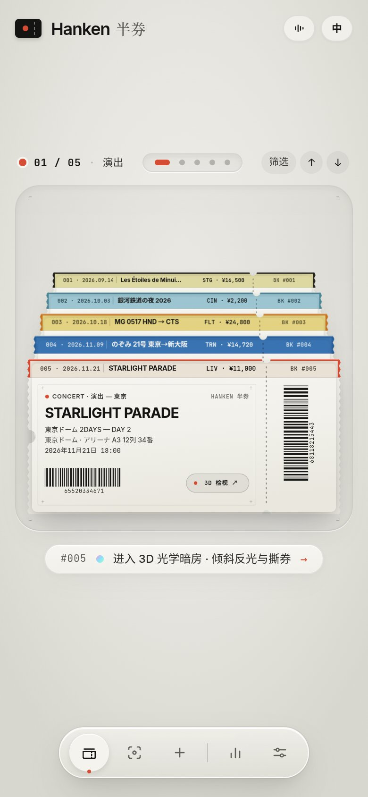

# 半券 Hanken

**简体中文** | [English](README.en.md) | [日本語](README.md)

机票、车票、电影票、演唱会门票的票根档案。票面文字在本机解析成日期、座位、价格等字段，再用 WebGL 把票重新渲染出来：倾斜时光泽跟着移动，可以翻面，也可以沿齿孔撕下副券。

> 开发中。浏览器里的本地功能已经能用；原生应用（OCR）、云端同步和云端识别还没做，也还没有上线。

<p></p>
<p>
  
  
</p>

## 现在能做什么

### 渲染器（`packages/renderer`）

- 8 种票型模板：演唱会（镭射）、JR 磁气券、登机牌、热敏电影票、剧场、体育、展览、通用票根。
- 6 种材质：道林纸、热敏纸、硬卡纸、镭射烫印、拉丝烫金、磁气券。
- 用指针或陀螺仪倾斜，反光跟着移动；可以翻面、沿齿孔撕下副券、打孔，纸张会随时间泛黄。
- 性能不够的设备自动降档，必要时改用 2D 绘制。
- 一个 Shader 覆盖所有材质和正反面；光照是计算出来的，不需要 HDRI 贴图。

### 识别（`packages/shared`）

纯 TypeScript，不依赖平台。

- 用中日英韩关键词判断票型，JR、登机牌、电影票和演出各有专用规则。
- 日期支持令和纪年、英文、韩文，以及票面没写年份的情况（按拍摄时间推断）；还能提取时间、座位、价格（日元 / 人民币）、区间、场馆和整理番号。
- 解析登机牌条码（BCBP），不输出姓名和订座号。送去云端之前，会先去掉订单号、姓名、会员号等行。
- 在 9 张合成的测试票面上，各字段都提取正确；其中 6 张在本机直接完成，另外 3 张标题置信度不够，按设计转给云端文字识别。

### 应用（`apps/app`）

- 档案：按票型、年份、标签、关键词筛选，按年月分组。
- 扫描：上传照片，拖动四个角做透视裁切；确认页高亮置信度低于 0.8 的字段。
- 详情：3D 票面，三种背景；可以附上当天的照片；生成 1800×1200 的分享海报，三种版式，默认遮住条码和精确座位。
- 编辑：8 种票型各有表单，边改边预览。
- 年度回顾；足迹地图，航程按大圆距离计算。
- 设置：中文、日文、英文界面，机械声效（Web Audio 实时合成），渲染档位，JSON 备份和导入，30 天回收站。
- 数据存在本机的 IndexedDB（Dexie），离线可用。第一次打开会放入几张虚构的示例票。

网页版没有原生 OCR，扫描页的识别文字来自 4 组内置样本（JR 新干线、BCBP 登机牌、TOHO 电影票、东京巨蛋演唱会），也可以自己输入或修改。

<p align="center"></p>

## 还没做

- Capacitor 7 原生壳和 OCR 插件（iOS 用 Vision，Android 用 ML Kit）。
- Supabase 后端：表结构、RLS、同步，以及调用 Gemini 的识别 Edge Function。提示词、输出 Schema 和结果合并已经写好，还没接 HTTP 调用。
- 用真实票据扩充识别的测试样本。
- 渲染器：打包字体子集、自己托管 detect-gpu 的跑分数据、印章、截图对比测试。

## 技术

pnpm workspace，TypeScript。应用用 React、TanStack Router、Tailwind CSS、Dexie、Zod、Zustand、i18next 和 Motion；渲染器用 three.js 和 React Three Fiber。测试用 Vitest，格式和检查用 Biome。

## 本地运行

需要 Node.js 22 或更高版本。

```bash
npx -y pnpm@10 install
npx -y pnpm@10 dev            # 应用 http://localhost:5173
npx -y pnpm@10 dev:renderer   # 渲染器演示页 http://localhost:5174
npx -y pnpm@10 test           # Vitest
npx -y pnpm@10 typecheck      # 类型检查
npx -y pnpm@10 lint           # Biome
```

演示页可以用 URL 参数固定画面：`/?ticket=0&tiltX=0.3&tiltY=0.2&quality=high&flipped=0&ui=0`（`ticket`：0 演唱会，1 JR，2 登机牌；`ui=0` 隐藏面板）。

## 文档

| 文件 | 内容 |
| --- | --- |
| [docs/01-requirements.md](docs/01-requirements.md) | 需求分析：背景、竞品、用户画像、功能和非功能需求、商业模式、风险 |
| [docs/02-architecture.md](docs/02-architecture.md) | 架构设计：技术选型、渲染引擎、扫描与识别、数据模型、同步、部署、成本 |
| [docs/03-development.md](docs/03-development.md) | 开发文档：仓库结构、编码规范、测试、发布、里程碑 |
| [docs/04-handoff.md](docs/04-handoff.md) | 交接文档：已完成的模块、公开接口、剩余任务的顺序 |

## README 截图

`docs/screenshots/` 里的图由 GitHub Actions 的「README 截图」工作流生成：在无头 Chrome 里用软件 WebGL 打开演示页和应用后截图。需要更新时，在 Actions 页面手动运行。
