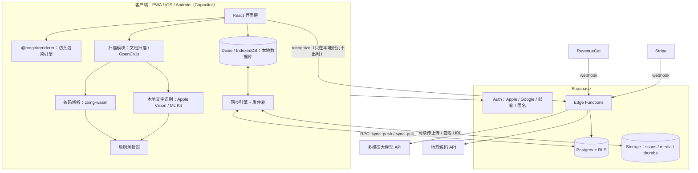
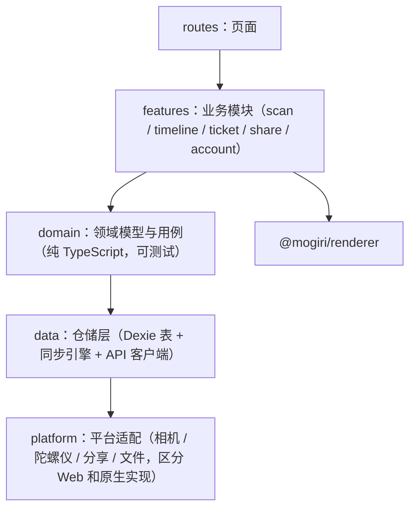
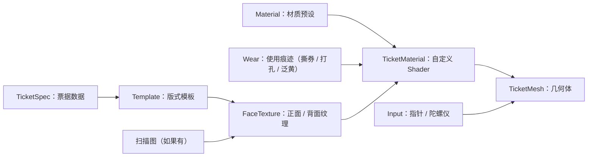
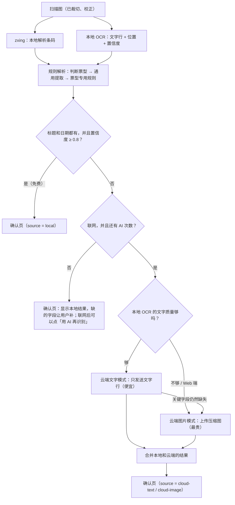
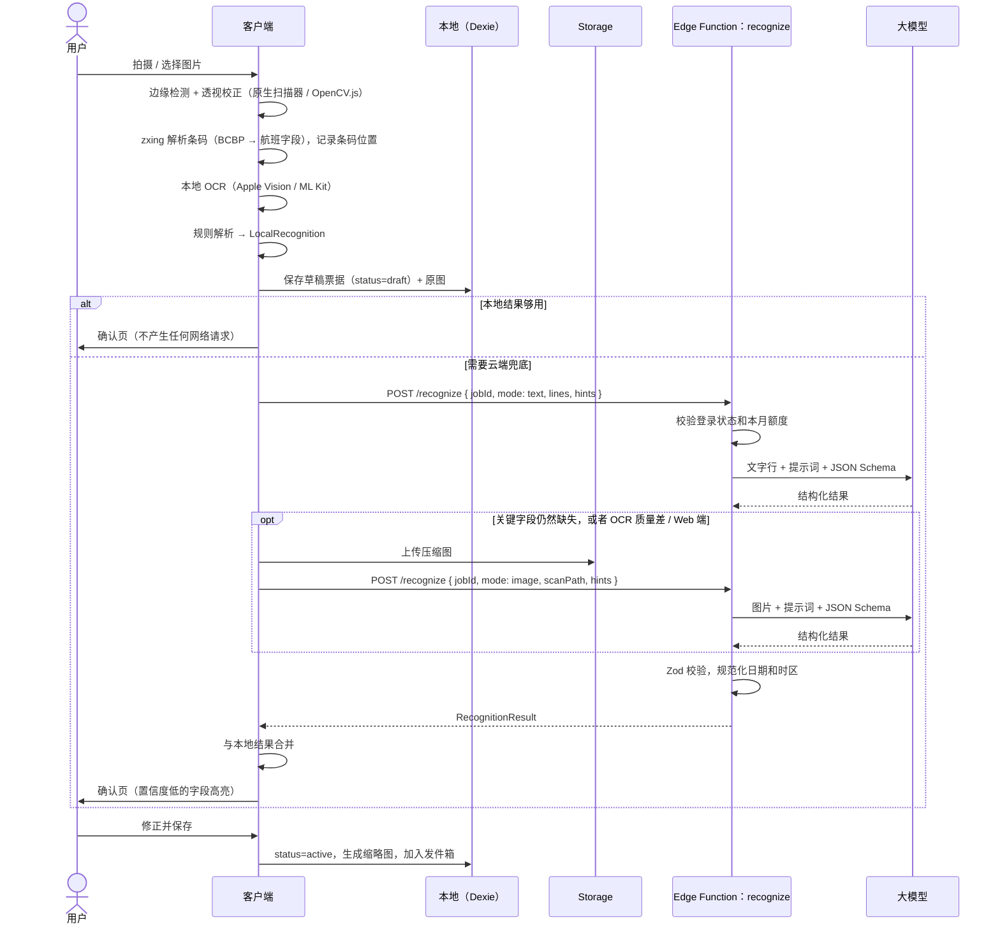
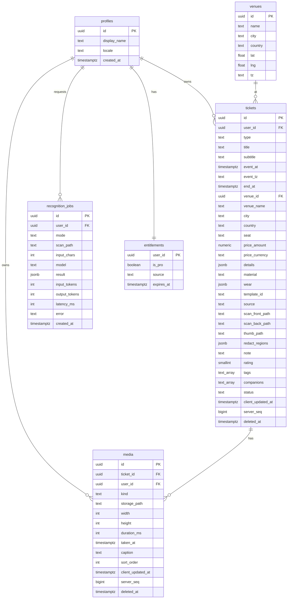
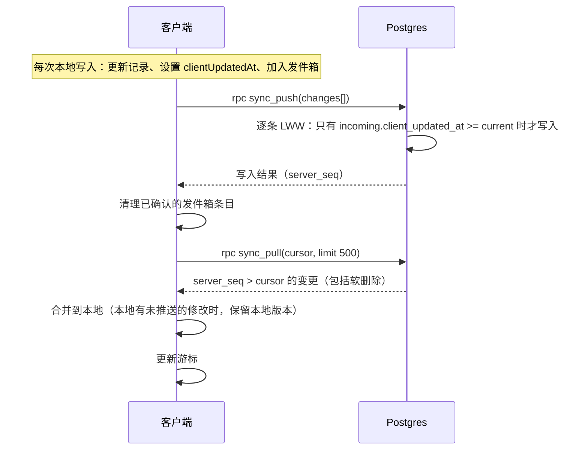
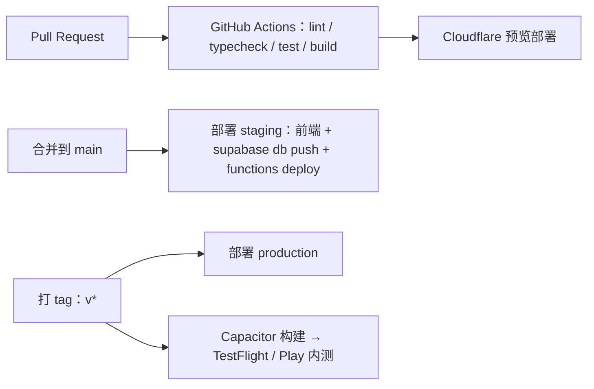

# 02 · 架构设计

> 对应需求：[01-requirements.md](./01-requirements.md) · 版本 v0.2（识别改为本地优先 + 云端兜底：§2、§3、§6、§7、§10、§12、§15、§16）

---

## 1. 架构原则

1. **本地优先**：数据先写入本机，界面立即响应；网络只负责同步，以及本地识别不出来时的云端兜底。
2. **渲染是核心资产**：仿真渲染引擎做成独立的包（`@mogiri/renderer`），可以单独开发、单独演示，以后也可以开源。
3. **一套代码，三个平台**：用 Web 技术同时覆盖 PWA、iOS 和 Android（通过 Capacitor 打包）。
4. **服务端尽量薄**：用 Supabase 托管的服务（数据库、登录、存储、边缘函数），不自己维护服务器。
5. **默认保护隐私**：图片私有；条码和文字优先在本地识别；分享时默认打码。
6. **可以降级**：任何设备都能用，好设备体验更好。

---

## 2. 技术选型

| 层             | 选型                                                                                                                                                                         | 理由                                                                                           | 备选 / 不选的原因                                                                     |
| -------------- | ---------------------------------------------------------------------------------------------------------------------------------------------------------------------------- | ---------------------------------------------------------------------------------------------- | ------------------------------------------------------------------------------------- |
| 语言           | TypeScript（严格模式）                                                                                                                                                       | 前端、后端、共享类型统一                                                                       | —                                                                                     |
| 前端框架       | **React 19 + Vite**                                                                                                                                                          | 你最熟悉；这是纯客户端的单页应用，Capacitor 需要静态打包产物                                   | Next.js：服务端渲染对离线 App 没有价值，反而增加复杂度                                |
| 3D 渲染        | **three.js + React Three Fiber + drei**                                                                                                                                      | 仿真材质、Shader、生态成熟                                                                     | 纯 Canvas2D：做不出光照和材质；Pixi：偏 2D                                            |
| 动效 / 手势    | Motion（framer-motion）+ @use-gesture/react                                                                                                                                  | 界面转场和手势                                                                                 | GSAP：备选，复杂时间线可以用它                                                        |
| 路由           | TanStack Router                                                                                                                                                              | 类型安全，支持按路由懒加载                                                                     | React Router                                                                          |
| 状态           | Zustand（界面状态）+ Dexie liveQuery（数据）                                                                                                                                 | 本地数据库就是数据源，界面自动响应数据变化                                                     | Redux：太重                                                                           |
| 本地数据库     | **Dexie（IndexedDB）**                                                                                                                                                       | 成熟，支持响应式查询，可以存图片等二进制数据                                                   | SQLite WASM：更强但体积大，Capacitor 下配置复杂                                       |
| 样式           | Tailwind CSS v4 + CSS 变量设计令牌                                                                                                                                           | 快                                                                                             | CSS Modules                                                                           |
| 校验           | Zod                                                                                                                                                                          | 前端、后端、AI 输出共用同一套数据结构定义                                                      | —                                                                                     |
| 国际化         | i18next                                                                                                                                                                      | 中文、日文、英文                                                                               | —                                                                                     |
| 原生外壳       | **Capacitor 7**                                                                                                                                                              | 直接复用 Web 代码；有相机、文档扫描、陀螺仪、分享、应用内购买等插件                            | React Native：R3F 在 RN 上能力弱，需要重写渲染                                        |
| 后端           | **Supabase**：Postgres、Auth、Storage、Edge Functions                                                                                                                        | 托管服务；行级安全（RLS）；支持匿名登录；你已经在用                                            | Firebase：关系查询弱                                                                  |
| 本地文字识别   | **iOS：Apple Vision**（`VNRecognizeTextRequest`）；**Android：Google ML Kit Text Recognition v2**（中文、日文、韩文模型打包进 App）；通过一个自己写的 Capacitor 插件统一接口 | 系统自带或免费 SDK；离线可用；不收费；支持中日英韩；返回每行文字的位置和置信度                 | 社区 OCR 插件：维护情况不稳定，而且需要的接口很简单（Swift / Kotlin 各约 100–200 行） |
| Web 端文字识别 | MVP：**不做本地 OCR，直接走云端图片模式**；之后评估 Tesseract.js                                                                                                             | Tesseract.js 的日文、花体字准确率差，语言包几 MB；PWA 不是主力平台                             | 见 03 文档 Q6                                                                         |
| 字段提取       | **本地规则解析器**（纯 TypeScript，放在 `packages/shared`）                                                                                                                  | 免费、可测试；固定版式的票（JR、登机牌、连锁影院）用规则就能准确提取                           | —                                                                                     |
| 云端兜底       | 大模型（Gemini Flash 系列）+ JSON Schema 结构化输出；**先文字模式，必要时图片模式**                                                                                          | 只处理本地搞不定的票；文字模式比图片模式便宜很多，也不用上传图片；通过抽象层可以切换模型提供商 | 每张票都交给大模型：每次都花钱、要联网、要上传图片                                    |
| 条码           | zxing-wasm（本地运行）                                                                                                                                                       | 解析 QR、PDF417、Aztec；登机牌的 BCBP 格式在本地解析                                           | —                                                                                     |
| 订阅           | **RevenueCat**（App Store、Google Play、Web 统一管理）                                                                                                                       | 统一管理会员权益，省去自己写收据校验                                                           | 自己实现：工作量大                                                                    |
| 实体商品支付   | Stripe                                                                                                                                                                       | 实体商品不需要走应用内购买                                                                     | —                                                                                     |
| 监控           | Sentry（错误）+ PostHog（产品分析、功能开关）                                                                                                                                | 有免费额度                                                                                     | —                                                                                     |
| 托管           | Cloudflare Pages（PWA）                                                                                                                                                      | 静态托管、全球 CDN、免费                                                                       | Vercel                                                                                |

---

## 3. 系统总览



---

## 4. 客户端架构

### 4.1 分层



- **platform 适配层**：每个能力都定义一个接口，分别实现 `web.ts` 和 `native.ts`，运行时用 `Capacitor.isNativePlatform()` 选择。业务代码不直接调用 Capacitor 插件。
- **domain 层**：不依赖 React。像「票据校验」「时区换算」「LWW 冲突合并」这样的逻辑都放在这里，用 Vitest 直接测试。

### 4.2 路由

| 路由            | 页面                | 是否懒加载                          |
| --------------- | ------------------- | ----------------------------------- |
| `/`             | 时间线（票夹）      | 否                                  |
| `/scan`         | 扫描 / 导入         | 是（OpenCV.js、zxing 只在这里加载） |
| `/scan/confirm` | 识别结果确认        | 是                                  |
| `/t/:id`        | 单张票详情（WebGL） | 是（three.js 独立分包）             |
| `/t/:id/edit`   | 编辑                | 是                                  |
| `/recap/:year`  | 年度回顾            | 是                                  |
| `/map`          | 足迹地图            | 是                                  |
| `/settings`     | 设置 / 账号 / 订阅  | 是                                  |

### 4.3 状态管理

- **持久化数据**（票、媒体、设置）：Dexie 是唯一的数据源。组件通过 `useLiveQuery` 订阅数据，写入后界面自动刷新。
- **界面临时状态**（扫描队列、渲染档位、弹窗）：Zustand。
- **服务端请求**（识别、订阅状态）：一个简单的 fetch 封装加上 Zustand 足够，**不引入** React Query，避免和本地数据库形成两个数据源。

---

## 5. 仿真渲染引擎 `@mogiri/renderer` ⭐

### 5.1 核心概念



| 概念            | 说明                                                                                              |
| --------------- | ------------------------------------------------------------------------------------------------- |
| **TicketSpec**  | 渲染需要的数据：尺寸（毫米）、票型、各字段、扫描图地址、材质、使用痕迹                            |
| **Template**    | 用 JSON 描述的版式：文字区域、条码、打孔线、Logo 位置。**只用于生成模式**                         |
| **FaceTexture** | 扫描模式直接使用扫描图；生成模式用 Canvas2D 按模板绘制，分辨率约 2048px，然后转成 `CanvasTexture` |
| **Material**    | 材质预设：`paper`、`thermal`、`cardstock`、`foil-holo`、`foil-gold`、`magnetic`                   |
| **Wear**        | 使用痕迹：`{ torn: boolean, punches: Point[], stamps: Stamp[], age: 0..1 }`                       |

### 5.2 几何

- 主体是一个细分平面（64 × 32 段），这样能做弯曲和撕裂；边缘加一圈侧面，体现约 0.2–0.4mm 的纸张厚度。
- 正面和背面是两套材质（双面票的背面用扫描背面图，单面票的背面用对应票型的默认背面）。
- 有副券的票型（登机牌、演唱会票）在打孔线位置**拆成两个网格**，方便做撕券动画。

### 5.3 Shader 设计

正面使用 `ShaderMaterial`（或者 `MeshPhysicalMaterial` + `onBeforeCompile`，以复用 three.js 自带的光照计算）。

| 输入                  | 作用                                                        |
| --------------------- | ----------------------------------------------------------- |
| `uAlbedo`             | 票面纹理                                                    |
| `uPaperNormal`        | 程序生成的纸纤维法线，可平铺，不同材质用不同强度            |
| `uRoughness`          | 基础粗糙度：热敏纸偏光滑，硬卡纸偏粗糙                      |
| `uFoilMask`           | 镭射或烫金区域蒙版（0–1），来自模板、云端识别结果或用户画笔 |
| `uWearMask`           | 打孔镂空、撕裂边缘、折痕                                    |
| `uAge`                | 泛黄和墨色褪色程度                                          |
| `uViewTilt` / `uTime` | 视角和时间                                                  |

**材质效果的实现思路**

- **镭射（foil-holo）**：近似薄膜干涉。用 `dot(N, V)` 加上噪声扰动得到薄膜厚度 → 用余弦调色板映射成光谱色 → 乘上菲涅尔项和镭射蒙版。再叠加一层闪粉：哈希噪声加阈值，只在特定角度闪亮。
- **烫金（foil-gold）**：金属度 1，粗糙度 0.25，加各向异性的拉丝噪声。
- **热敏纸（thermal）**：轻微光泽；墨色按 `uAge` 降低对比度，偏向棕灰色；底色往米黄色过渡。
- **磁气券（magnetic）**：背面整面使用深棕黑色、带金属感的磁性涂层材质。
- **环境光**：一张小尺寸摄影棚 HDRI（< 300KB），用 PMREM 预过滤。

### 5.4 交互

- **倾斜输入**：
  - 指针拖动：适用于桌面和手机触摸。
  - 陀螺仪：Web 端使用 `DeviceOrientationEvent`，**iOS 需要在用户点击后调用 `requestPermission()`**；原生端使用 `@capacitor/motion`。
  - 两种输入合并后，用阻尼平滑（`maath/easing.damp`）驱动票的旋转（±18°）和光照。
- **翻转**：点击或滑动，绕 Y 轴旋转 180°，使用弹簧动画。
- **撕券**：沿打孔线拖动副券，超过阈值后副券脱离并有物理感地飞出。撕裂边缘的形状由一维噪声生成，**两片的边缘互补**。完成后把 `wear.torn = true` 写入数据库。
- **打孔 / 盖章**：用贴花（decal）的方式写入 `uWearMask`。

### 5.5 性能与降级

| 档位      | 条件                                              | 效果                                                        |
| --------- | ------------------------------------------------- | ----------------------------------------------------------- |
| **T3 高** | GPU 档位 ≥ 2，并且运行时帧率 ≥ 55                 | 全部效果，DPR = min(2, 设备像素比)                          |
| **T2 中** | GPU 档位 1，或者帧率掉到 40–55                    | DPR 1.5，关闭闪粉，降低环境贴图分辨率                       |
| **T1 低** | 不支持 WebGL / 帧率 < 30 / 开启了「减弱动态效果」 | **不用 WebGL**：静态缩略图 + CSS 3D 倾斜 + CSS 渐变模拟光泽 |

- 初始档位用 `detect-gpu` 判断，运行时用 drei 的 `PerformanceMonitor` 动态升降。
- **整个 App 只保留一个 WebGLRenderer**，详情页之间复用。原因：iOS 对 WebGL 上下文数量有上限，反复创建还容易泄漏内存。
- 纹理用完后显式 `dispose()`。超过 2048px 的纹理先缩小；移动端优先考虑 KTX2 格式。
- **时间线不使用 WebGL**，全部用预渲染的缩略图（见 5.6）。

### 5.6 缩略图

- 票据保存或者材质、痕迹发生变化时，在客户端用同一个渲染器离屏渲染一张固定角度的图（WebP，宽 600px），存到本地，并加入同步队列上传到 `thumbs` 存储桶。
- 好处：服务端不需要 GPU；列表和详情页看起来一致；换设备后可以直接下载缩略图，不用重新渲染。

### 5.7 导出

- **PNG**：离屏渲染 1080×1350 或 1080×1920 的画面（带背景和可选水印），读取像素生成文件。
- **视频**：按一条固定的倾斜路径**逐帧确定性渲染**，用 WebCodecs `VideoEncoder` + `mp4-muxer` 编码成 MP4。不支持 WebCodecs 时，退回到 `canvas.captureStream()` + `MediaRecorder`。
- **打码**：导出前把二维码和条码区域（扫描时记录的位置）替换成马赛克。

---

## 6. 扫描与识别流程

### 6.1 总体思路：三级识别

**能在手机上免费识别的，就不调用大模型。** 只有本地识别不出关键字段时，才按「文字模式 → 图片模式」的顺序调用云端。



| 级别           | 在哪里运行                   | 输入                               | 费用                   | 适合的票                                                             |
| -------------- | ---------------------------- | ---------------------------------- | ---------------------- | -------------------------------------------------------------------- |
| ① 本地识别     | 手机                         | 条码 + 本地 OCR 文字               | 免费，离线可用         | 登机牌（条码）、JR 车票、连锁影院票等固定版式的票                    |
| ② 云端文字模式 | Edge Function → 大模型       | 本地 OCR 文字行（去掉敏感信息后）  | 便宜（只有文字 token） | 文字认得清，但版式复杂、规则提取不出来的票，比如很多演唱会票、话剧票 |
| ③ 云端图片模式 | Edge Function → 多模态大模型 | 压缩图（长边 1280，JPEG 质量 0.8） | 最贵                   | 花体字、镭射反光、手写；Web 端（没有本地 OCR）                       |

**判断条件**（数值先按经验设定，之后用评测集调）：

- **本地结果够用**：`title` 和 `eventAt` 都有，并且置信度都 ≥ 0.8。
- **OCR 文字质量够**：所有文字行的平均置信度 ≥ 0.6，并且识别出的有效字符 ≥ 15 个。
- **文字模式不够用**：大模型返回的 `title` 或 `eventAt` 缺失或者置信度 < 0.5，自动升级到图片模式。同一张票的升级**只算 1 次 AI 额度**。

### 6.2 时序



### 6.3 扫描实现

- 原生端：使用文档扫描插件（iOS 调用 VisionKit，Android 调用 ML Kit Document Scanner），自带边缘检测和透视校正。
- Web 端：用 `getUserMedia` 打开相机或者选择文件 → 在 Web Worker 中**懒加载** OpenCV.js 检测四边形（只在扫描页加载，加载后缓存）→ 检测失败时让用户手动拖动四个角。

### 6.4 本地 OCR

- 自己写一个 Capacitor 插件（`ocr`），iOS 和 Android 各实现一个方法：

  ```ts
  interface OcrPlugin {
    recognize(opts: { imagePath: string; languages: string[] }): Promise<{ lines: OcrLine[] }>;
  }
  type OcrLine = {
    text: string;
    box: [x: number, y: number, w: number, h: number]; // 相对坐标 0..1
    confidence: number;                                // 0..1
  };
  ```
- **iOS**：`VNRecognizeTextRequest`，`recognitionLevel = .accurate`，语言按优先级传 `ja`、`zh-Hans`、`zh-Hant`、`en`、`ko`（iOS 16 起支持日文和韩文，和 App 的最低系统版本一致）。
- **Android**：ML Kit Text Recognition v2。日文、中文、韩文各有一个识别模型，**打包进 App**（每个模型会让安装包变大几 MB，具体以实测为准），避免首次使用时还要联网下载模型。按 App 语言和用户所在地区决定先跑哪个模型，置信度低时再换一个模型试。
- **Web**：MVP 不做本地 OCR，直接走云端图片模式（见 03 文档 Q6）。
- 平台适配放在 `platform/ocr/`，业务代码只调用统一接口。

### 6.5 规则解析器（`packages/shared/src/recognize/`）

纯 TypeScript，不依赖平台，**用评测集里真实票据的 OCR 输出做测试**。

| 步骤           | 做什么                           | 例子                                                                                                                                                                                                                               |
| -------------- | -------------------------------- | ---------------------------------------------------------------------------------------------------------------------------------------------------------------------------------------------------------------------------------- |
| ① 判断票型     | 按各语言的关键词打分             | `乗車券` `特急券` `号車` → train；`BOARDING PASS` `搭乗券` `GATE` → flight；`開演` `開場` `入场` → concert / theater；`スクリーン` `影厅` → movie                                                                                  |
| ② 通用提取     | 日期、时间、座位、价格、车站对   | `2026年11月9日(月)`、`令和8年`、`2026.11.09`、`Nov 9, 2026`；`開演 18:30`；`A列12番`、`3排5号`、`1階 Bブロック`；`¥8,800`、`8,800円`、`￥45`；`東京 → 新大阪`                                                                      |
| ③ 票型专用规则 | 固定版式的票按位置和格式精确提取 | `jr.ts`：车次（`のぞみ 123号`）、`○号車 ○番`、乘车区间；`boarding-pass.ts`：以 BCBP 为准，OCR 只补登机口、登机时间；`cinema.ts`：TOHO、イオンシネマ、109シネマズ、万达等连锁影院                                                   |
| ④ 推断和补全   | 补全缺失的信息                   | **票上没有年份**（JR 车票常见）：以拍摄时间或图片 EXIF 时间为基准，取最近的合理日期：允许落在基准之后的一个「未来窗口」内（火车 31 天、演唱会 180 天等，见 `recognize/config.ts`），票面印了星期时以星期为准；时区按城市或车站推断 |
| ⑤ 计算置信度   | 每个字段一个置信度               | 置信度由三部分决定：OCR 本身的置信度、规则匹配的确定程度、和其他字段是否一致（比如开场时间早于开演时间）                                                                                                                           |

> [!NOTE]
> **标题最难靠规则提取**，尤其是演唱会票：一般取「字号最大、而且不是日期 / 座位 / 价格」的那一行，置信度给得比较低。所以演唱会票会比较常走云端文字模式，这在预期之内。

```ts
type LocalRecognition = {
  result: Partial<RecognitionResult>; // 本地能提取到的字段
  ocrQuality: number; // 0..1，用来决定走文字模式还是图片模式
  matchedRules: string[]; // 例如 ['classify:train', 'jr:route', 'date:jp-md']，用于统计
  barcodeFields?: string[]; // 条码解析出的字段路径，合并时永远优先
  typeConfidence?: number; // 票型判断的置信度
};
```

### 6.6 云端兜底

- **文字模式发送前先去掉敏感信息**：去掉匹配 `予約番号`、`受付番号`、`订单号`、`Booking`、`お名前`、`会員番号` 的行，以及 10 位以上的连续数字。条码内容从不发送。
- **合并规则**：逐个字段取置信度更高的那个；**条码解析出的字段永远优先**（置信度视为 1）。
- **额度**：只有调用云端才计入额度。同一个 `jobId` 从文字模式升级到图片模式只算 1 次。本地识别不限次数。

**识别结果结构**（Zod 定义，同时作为大模型的 JSON Schema；本地规则解析器也输出同一个结构）

```ts
const RecognitionResult = z.object({
  type: z.enum(['flight', 'train', 'movie', 'concert', 'theater', 'sports', 'exhibition', 'other']),
  title: Field(z.string()),
  subtitle: Field(z.string()).optional(),
  eventAt: Field(z.string()), // ISO 8601 本地时间，例如 2026-11-09T18:30
  timezone: Field(z.string()).optional(), // IANA 时区，按场馆或城市推断
  venue: Field(z.string()).optional(),
  city: Field(z.string()).optional(),
  country: Field(z.string()).optional(), // ISO 3166-1 alpha-2
  seat: Field(z.string()).optional(),
  price: Field(z.object({ amount: z.number(), currency: z.string() })).optional(),
  details: z.record(z.string(), Field(z.string())), // 票型扩展字段
  language: z.string(),
  hasFoil: z.boolean().optional(), // 票面是否有镭射或烫金（只有图片模式能判断；本地和文字模式用票型模板的默认值）
  sensitive: z.array(z.enum(['name', 'booking_ref', 'barcode'])),
});
// Field<T> = { value: T, confidence: number /* 0..1 */ }
// 客户端另外记录 source: 'local' | 'cloud-text' | 'cloud-image'
```

**模型调用抽象**：`packages/shared/src/ai/provider.ts` 定义 `recognizeText(lines, hints)` 和 `recognizeImage(image, hints)` 两个接口，以后可以换成其他模型提供商。`hints` 的类型里没有条码字段，从类型上保证条码不会发到云端；Schema 由实现方用 `toJsonSchema()` 生成。实现细节见 [04-handoff.md](./04-handoff.md) §3、§4。

---

## 7. 数据模型

### 7.1 实体关系



### 7.2 关键设计

- **主键由客户端生成**（UUID v7，按时间有序），离线时也能直接创建记录、互相引用。
- **时间 + 时区**：`event_at` 用 timestamptz 存绝对时间点，`event_tz` 存 IANA 时区（比如 `Asia/Tokyo`）。界面**按活动当地时间显示**。在东京看的演出，人在上海打开时也应该显示东京时间。
- **扩展字段**：每个票型独有的字段放在 `details jsonb` 里，由前后端共用的 Zod Schema 校验。这样新增票型不需要改表结构。
- **软删除**：用 `deleted_at` 标记，30 天后由定时任务（pg_cron）彻底删除，同时删除存储里的文件。
- **`server_seq`**：用一个全局递增序列，每次写入时通过触发器更新。它是增量拉取的游标，避免依赖各设备的时钟。
- **`recognition_jobs` 只记录云端调用**：`id` 就是客户端生成的 `jobId`；`mode` 记录最终用的是 `text` 还是 `image`（升级时更新同一行），`scan_path` 只在图片模式下有值。**文字模式不保存发送的文字原文**，只记录字符数。本地识别不在服务端留下任何记录。

### 7.3 行级安全（示例）

```sql
alter table tickets enable row level security;

create policy "own tickets" on tickets
  for all using (user_id = auth.uid()) with check (user_id = auth.uid());

-- Storage：路径约定为 {user_id}/{ticket_id}/{file}
create policy "own files" on storage.objects
  for all using (
    bucket_id in ('scans','media','thumbs')
    and (storage.foldername(name))[1] = auth.uid()::text
  );
```

---

## 8. 本地优先与同步

### 8.1 本地数据表（Dexie）

```ts
db.version(1).stores({
  tickets: 'id, eventAt, type, status, [status+eventAt], *tags, serverSeq',
  media: 'id, ticketId, [ticketId+sortOrder]',
  blobs: 'key', // 原图、缩略图、媒体文件的二进制数据
  outbox: '++seq, entity, entityId',
  meta: 'key', // 同步游标、设备 ID、设置
});
```

### 8.2 同步协议



- **什么时候同步**：App 启动、回到前台、网络恢复、本地写入后（防抖 2 秒），以及原生端的后台任务。
- **冲突策略**：以记录为单位的「最后写入胜出」（LWW）。对于个人数据，这已经足够；以后做共享票夹时，再考虑字段级合并。
- **文件**：先同步记录，文件单独走上传队列（Supabase Storage 支持 TUS 可续传上传）。另一台设备看到记录后，按需下载文件，并缓存在 `blobs` 表里（缓存按 LRU 淘汰，原图不清理）。
- **游客合并到账号**：游客使用 **Supabase 匿名登录**（已经有 `auth.uid()`，所以能调用识别接口，只是额度较低；不开启云同步）。用户登录后，通过身份关联（`linkIdentity`）把匿名账号升级成正式账号，`user_id` 保持不变，然后开启同步，全部推送一次。

---

## 9. 存储

| 存储桶   | 内容                   | 规格                                                    | 访问方式                              |
| -------- | ---------------------- | ------------------------------------------------------- | ------------------------------------- |
| `scans`  | 扫描原图（正面和背面） | JPEG，长边 ≤ 3000                                       | 私有，签名 URL（1 小时）              |
| `media`  | 用户照片、视频         | 照片转成 WebP 或 HEIC，长边 ≤ 2560；视频 ≤ 60 秒，H.264 | 私有，签名 URL                        |
| `thumbs` | 票据缩略图             | WebP，宽 600                                            | 私有，签名 URL（24 小时），客户端缓存 |

照片的 EXIF 元数据：保留拍摄时间，**默认去掉 GPS 位置**（地点信息已经保存在票据上）。

---

## 10. 服务端接口

| 名称                                | 类型          | 说明                                                                                                                   |
| ----------------------------------- | ------------- | ---------------------------------------------------------------------------------------------------------------------- |
| `sync_push(changes jsonb)`          | Postgres RPC  | 批量写入，逐条按 LWW 处理                                                                                              |
| `sync_pull(cursor bigint, lim int)` | Postgres RPC  | 增量拉取                                                                                                               |
| `recognize`                         | Edge Function | 云端兜底识别（只在本地识别不出时调用）：校验额度 → 文字模式或图片模式调用大模型 → 校验结果 → 记录到 `recognition_jobs` |
| `geocode`                           | Edge Function | 场馆名 → 经纬度和时区，结果缓存在 `venues` 表                                                                          |
| `delete-account`                    | Edge Function | 删除存储文件、全部数据和登录账号（使用 service role 权限）                                                             |
| `revenuecat-webhook`                | Edge Function | 更新 `entitlements` 表                                                                                                 |
| `stripe-webhook`                    | Edge Function | 处理实体周边订单（v1.x）                                                                                               |
| `purge-deleted`                     | pg_cron       | 每天彻底删除软删除超过 30 天的数据                                                                                     |

**额度控制**：`recognize` 根据 `entitlements.is_pro` 和本月 `recognition_jobs` 的行数判断是否放行（同一个 `jobId` 只占一行，所以从文字模式升级到图片模式只算 1 次）。免费用户每月 20 次，匿名用户每月 5 次。本地识别不受限制。

---

## 11. 登录与付费

- **登录**：Supabase Auth，支持 Apple、Google、邮箱验证码，以及匿名登录。原生端用系统原生登录拿到 ID Token，再调用 `signInWithIdToken`。
- **付费**：RevenueCat 统一管理 App Store、Google Play 和 Web（Stripe）三个渠道的订阅，权益名为 `pro`。webhook 写入 `entitlements` 表。**客户端只用这个状态决定显示什么，真正的限制在服务端执行**。

---

## 12. 安全与隐私

- 所有表开启 RLS；service role 密钥只在 Edge Functions 里使用。
- **本地能识别的票，不向任何 AI 服务发送数据。** 需要云端兜底时优先用文字模式，并在发送前去掉订单号、姓名等敏感行（见 §6.6）。
- 大模型提供商选择不会用请求数据训练模型的付费接口（**免费档的 API 可能把数据用于改进模型，只能在开发阶段用测试票据调用**）；识别用的压缩图在识别完成后不额外保留（原图只存在用户自己的 `scans` 存储桶里）。
- 敏感字段（姓名、订单号）可以识别出来，但**默认不显示在仿真票面上**，导出时打码。
- 账号删除、数据导出、隐私政策页面是上架 App Store 的必备条件，需要在 MVP 阶段完成。

---

## 13. 部署与环境

| 环境       | 前端                      | 后端                           | 用途                  |
| ---------- | ------------------------- | ------------------------------ | --------------------- |
| local      | `vite dev`                | `supabase start`（Docker）     | 本地开发              |
| staging    | Cloudflare Pages 预览地址 | Supabase 项目 `mogiri-staging` | 测试、TestFlight 内测 |
| production | Cloudflare Pages 正式地址 | Supabase 项目 `mogiri-prod`    | 正式环境              |



---

## 14. 监控

- **Sentry**：前端和原生端的错误、性能追踪，上传 source map。
- **PostHog**：关键事件包括 `scan_started`、`recognition_done`（耗时、识别路径 `local` / `cloud-text` / `cloud-image`、票型、命中的规则、被修改的字段数）、`ticket_created`、`ticket_opened`（渲染档位、平均帧率）、`share_exported`、`paywall_viewed`、`purchase`。**本地识别完成率**按票型统计，用来决定先给哪种票型补规则。
- **Supabase**：Edge Function 日志；`recognition_jobs` 表本身就是 AI 成本和质量的看板数据。

---

## 15. 成本估算（上线初期，粗略）

| 项目                                           | 月成本                 |
| ---------------------------------------------- | ---------------------- |
| Supabase Pro                                   | 约 \$25                |
| AI 兜底识别（每月录入 1 万张票，见下方假设）   | 约 \$2–6               |
| Cloudflare Pages / Sentry / PostHog            | \$0（免费额度）        |
| RevenueCat                                     | 月收入 \$2.5k 以内免费 |
| Apple 开发者 \$99/年 + Google Play 一次性 \$25 | 约 \$9                 |
| **合计**                                       | **约 \$36–40/月**      |

**AI 费用的估算假设**（都需要用评测集和上线数据验证）：

- 1 万张票里，60% 本地识别完成（\$0），30% 走文字模式，10% 走图片模式。
- 图片模式每次约 \$0.001–0.003（v0.1 的估算）；文字模式只发几百个字符，按每次约 \$0.0003–0.001 估算。
- 3,000 次文字模式约 \$1–3，加上 1,000 次图片模式约 \$1–3，合计约 \$2–6。对比 v0.1 全部走图片模式的约 \$10–30，**大约省下 80%**。
- 开发阶段只有自己测试，可以用 Gemini API 的免费额度，但**只能用测试票据**（见 §12）。

---

## 16. 关键决策记录（ADR 摘要）

| #       | 决策                                                                                                | 原因                                                                                                                         |
| ------- | --------------------------------------------------------------------------------------------------- | ---------------------------------------------------------------------------------------------------------------------------- |
| ADR-001 | 用 Vite 单页应用 + Capacitor，而不是 Next.js 或 React Native                                        | 离线优先、复用 Web 端的 WebGL 能力、一套代码覆盖三个平台                                                                     |
| ADR-002 | 本地数据库是唯一的数据源，服务端只负责同步                                                          | 响应速度快、离线可用、游客模式实现简单                                                                                       |
| ADR-003 | 同步用记录级 LWW + `server_seq` 游标                                                                | 个人数据很少有冲突；实现简单可靠                                                                                             |
| ADR-004 | 渲染引擎做成独立的包，并且只保留一个 WebGL 上下文                                                   | 方便单独演示和复用；避免 iOS 上的上下文和内存问题                                                                            |
| ADR-005 | 缩略图在客户端渲染                                                                                  | 服务端不需要 GPU，列表和详情页视觉一致                                                                                       |
| ADR-006 | 识别分三级：**本地（条码 + 系统 OCR + 规则）→ 云端文字模式 → 云端图片模式**；所有级别输出同一个结构 | 大部分票免费、离线也能识别；只把本地搞不定的票交给大模型，而且优先只发文字，成本低、隐私好；保留大模型兜底，复杂版式也能识别 |
| ADR-007 | 游客使用 Supabase 匿名登录                                                                          | 游客也能使用 AI 兜底识别；升级成正式账号时 `user_id` 不变                                                                    |
| ADR-008 | 本地 OCR 自己写 Capacitor 插件；Web 端 MVP 不做本地 OCR                                             | 需要的接口很简单，自己写更可控；Tesseract.js 日文准确率差、语言包大，PWA 不是主力平台                                        |
