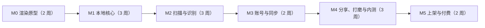

# 03 · 开发文档

> 对应：[01-requirements.md](./01-requirements.md) · [02-architecture.md](./02-architecture.md) · 版本 v0.2（新增本地识别相关的结构、开发指南、测试和任务）

---

## 1. 仓库结构

使用 pnpm workspace 管理的 monorepo：

```
mogiri/
├─ apps/
│  └─ app/                      # 主应用：Vite + React PWA，同时也是 Capacitor 的 Web 层
│     ├─ src/
│     │  ├─ routes/             # 页面（TanStack Router 文件路由）
│     │  ├─ features/
│     │  │  ├─ scan/            # 扫描、裁切、识别确认
│     │  │  ├─ timeline/        # 票夹视图、网格视图、筛选
│     │  │  ├─ ticket/          # 详情页、编辑、照片
│     │  │  ├─ share/           # 导出 PNG / 视频、年度回顾
│     │  │  └─ account/         # 登录、订阅、设置、导出、删除账号
│     │  ├─ domain/             # 纯 TypeScript：用例、规则、LWW 合并
│     │  ├─ data/               # Dexie、同步引擎、Supabase 客户端、发件箱
│     │  ├─ platform/           # 平台能力（camera / motion / share / fs / ocr），区分 web 和 native 实现
│     │  ├─ ui/                 # 通用组件、设计令牌
│     │  ├─ i18n/               # zh-CN / ja / en
│     │  └─ main.tsx
│     ├─ ios/  android/         # Capacitor 原生工程（需要提交到仓库）
│     ├─ capacitor.config.ts
│     └─ vite.config.ts
├─ packages/
│  ├─ renderer/                 # @mogiri/renderer：仿真渲染引擎
│  │  ├─ src/
│  │  │  ├─ TicketCanvas.tsx    # 全局唯一的 Canvas
│  │  │  ├─ TicketMesh.tsx
│  │  │  ├─ materials/          # paper / thermal / cardstock / foil / magnetic
│  │  │  ├─ shaders/            # *.glsl（通过 vite-plugin-glsl 导入）
│  │  │  ├─ templates/          # 版式模板 JSON + Canvas2D 绘制
│  │  │  ├─ wear/               # 撕券、打孔、印章、泛黄
│  │  │  ├─ input/              # 指针和陀螺仪输入合并
│  │  │  ├─ export/             # 导出 PNG / MP4
│  │  │  └─ quality/            # GPU 档位、降级逻辑
│  │  └─ playground/            # 独立的演示页（`pnpm dev:renderer`）
│  ├─ shared/                   # Zod 数据结构、类型、常量、AI 提供商接口
│  │  └─ src/recognize/         # 本地识别：票型判断、通用提取、票型专用规则（jr / boarding-pass / cinema …）、结果合并
│  └─ capacitor-ocr/            # 自己写的 Capacitor 插件：iOS（Apple Vision，Swift）/ Android（ML Kit，Kotlin）
├─ supabase/
│  ├─ migrations/               # SQL 迁移
│  ├─ functions/                # Edge Functions（Deno）
│  │  ├─ recognize/
│  │  ├─ geocode/
│  │  ├─ delete-account/
│  │  └─ revenuecat-webhook/
│  ├─ seed.sql
│  └─ config.toml
├─ docs/
└─ .github/workflows/
```

---

## 2. 本地环境

### 2.1 前置依赖

| 工具           | 版本                           |
| -------------- | ------------------------------ |
| Node.js        | 22 LTS                         |
| pnpm           | 9+                             |
| Docker Desktop | 最新（运行本地 Supabase 需要） |
| Supabase CLI   | 最新                           |
| Xcode          | 16+（iOS 开发）                |
| Android Studio | 最新（Android 开发）           |

### 2.2 启动

```bash
pnpm install
cp apps/app/.env.example apps/app/.env.local
supabase start                     # 启动本地 Postgres、Auth、Storage
supabase db reset                  # 执行迁移和种子数据
supabase functions serve           # 本地运行 Edge Functions
pnpm dev                           # http://localhost:5173
pnpm dev:renderer                  # 渲染引擎演示页 http://localhost:5174
```

真机调试（陀螺仪和相机需要 HTTPS 或原生环境）：

```bash
pnpm dev --host                    # 配合 mkcert 本地证书，用手机访问局域网地址
pnpm cap:ios                       # build → cap sync → 打开 Xcode
```

### 2.3 环境变量

| 变量                                                    | 位置              | 说明              |
| ------------------------------------------------------- | ----------------- | ----------------- |
| `VITE_SUPABASE_URL`                                     | app               | Supabase 项目地址 |
| `VITE_SUPABASE_ANON_KEY`                                | app               | 公开的 anon key   |
| `VITE_SENTRY_DSN`                                       | app               | 可选              |
| `VITE_POSTHOG_KEY`                                      | app               | 可选              |
| `VITE_REVENUECAT_IOS_KEY` / `_ANDROID_KEY` / `_WEB_KEY` | app               | 订阅              |
| `AI_PROVIDER` / `AI_API_KEY` / `AI_MODEL`               | functions secrets | 大模型配置        |
| `GEOCODE_API_KEY`                                       | functions secrets | 地理编码          |
| `REVENUECAT_WEBHOOK_SECRET`                             | functions secrets | webhook 签名校验  |

> 🔒 Functions 的密钥用 `supabase secrets set` 设置，**不要提交到仓库**。`.env.local` 已经加入 gitignore。

---

## 3. 常用命令

| 命令                                | 作用                                                                     |
| ----------------------------------- | ------------------------------------------------------------------------ |
| `pnpm dev` / `pnpm dev:renderer`    | 开发服务器                                                               |
| `pnpm build`                        | 构建所有包                                                               |
| `pnpm lint` / `pnpm format`         | Biome 代码检查 / 格式化                                                  |
| `pnpm typecheck`                    | `tsc -b` 类型检查                                                        |
| `pnpm test`                         | Vitest 单元测试                                                          |
| `pnpm test:e2e`                     | Playwright 端到端测试                                                    |
| `pnpm test:visual`                  | 渲染器截图对比测试                                                       |
| `pnpm db:new <name>`                | 新建迁移：`supabase migration new`                                       |
| `pnpm db:types`                     | 根据数据库生成 TypeScript 类型，输出到 `packages/shared/src/db.types.ts` |
| `pnpm cap:ios` / `pnpm cap:android` | 构建、同步并打开原生工程                                                 |

---

## 4. 编码规范

- **TypeScript 严格模式**，禁止 `any`（确实需要时写 `// biome-ignore` 并说明原因）。
- **命名**：组件用 `PascalCase.tsx`，hooks 用 `useXxx.ts`，其他文件用 `kebab-case.ts`。
- **依赖方向**：`routes → features → domain → data → platform`，**不允许反向依赖**；`renderer` 不依赖 `apps/app` 里的任何代码。
- **平台能力只通过 `platform/` 调用**，业务代码禁止直接 import `@capacitor/*`。
- **所有外部数据都要过 Zod 校验**：服务端返回、AI 结果、导入的 JSON。
- **时间**：统一使用 `Temporal`（polyfill）或 `date-fns-tz`；禁止用 `new Date(string)` 解析不带时区的时间。
- **界面文案**：全部走 i18n key，不允许在代码里写死中文或日文。
- **提交信息**：Conventional Commits，例如 `feat(renderer): holo foil shader`。
- **分支**：`main` 始终可以发布；功能开发用 `feat/xxx` 分支，通过 PR 合并（一个人开发也走 PR，好让 CI 检查）。

---

## 5. 模块开发指南

### 5.1 新增一种票型

1. `packages/shared/src/ticket-types.ts`：在 `TicketType` 枚举里加上新类型，并定义它的 `details` Zod Schema。
2. `packages/renderer/src/templates/<type>.json`：设计默认版式模板。
3. `packages/shared/src/recognize/classify.ts`：加上这种票型的关键词（中、日、英、韩）；如果是固定版式的票，在 `rules/<type>.ts` 写专用规则，并在 `fixtures/` 里加上真实票据的 OCR 输出作为测试用例（见 §5.7）。
4. `packages/shared/src/ai/prompt.ts`：在云端兜底的提示词里补充这种票型的识别说明和示例。
5. `apps/app/src/features/ticket/forms/<Type>Fields.tsx`：编辑表单。
6. i18n：在 3 种语言里加上字段名。
7. 在渲染器演示页加一个示例，然后更新截图对比测试的基准图。

### 5.2 版式模板格式

```jsonc
{
  "id": "concert-holo-v1",
  "size": { "w": 180, "h": 70, "unit": "mm" },
  "stub": { "at": 140, "perforation": "dots" }, // 副券位置（毫米）
  "background": { "color": "#f4efe6", "pattern": "guilloche" },
  "regions": [
    {
      "kind": "text",
      "bind": "title",
      "x": 10,
      "y": 12,
      "w": 120,
      "font": "display",
      "size": 7,
      "weight": 700,
      "fit": "shrink"
    },
    { "kind": "text", "bind": "eventAt", "format": "date.long", "x": 10, "y": 30 },
    { "kind": "text", "bind": "seat", "x": 10, "y": 50, "font": "mono" },
    { "kind": "barcode", "bind": "barcode", "x": 145, "y": 20, "w": 28, "h": 28, "redact": true },
    { "kind": "foil", "shape": "rect", "x": 0, "y": 0, "w": 30, "h": 70 }
  ]
}
```

- `bind` 引用的是 TicketSpec 的字段路径（比如 `details.flightNo`）。
- 字体：Noto Sans JP / SC（按需取子集）、等宽字体、点阵字体（热敏纸用），都需要先确认商用授权。

### 5.3 新增一种材质

1. 在 `materials/<name>.ts` 里导出 `MaterialPreset`，包括 uniform 默认值、需要用到的 Shader 功能开关，以及 T2 档的降级参数。
2. Shader 用 `#define` 开关组合功能，**避免为每种材质单独写一个 Shader**：

   ```glsl
   #ifdef USE_FOIL
     vec3 film = thinFilm(dot(N, V), noise(vUv * 40.0));
     color = mix(color, film, foilMask * fresnel);
   #endif
   ```
3. 在 `quality/` 里注册这种材质在 T2 和 T1 档位的表现。
4. 在演示页里调好参数（用 leva 面板），然后把参数写死到预设里。

### 5.4 本地数据写入的标准流程

```ts
// data/tickets.repo.ts
export async function updateTicket(id: string, patch: TicketPatch) {
  const parsed = TicketPatchSchema.parse(patch);
  await db.transaction('rw', db.tickets, db.outbox, async () => {
    const now = new Date().toISOString();
    await db.tickets.update(id, { ...parsed, clientUpdatedAt: now });
    await db.outbox.add({ entity: 'tickets', entityId: id, op: 'upsert', at: now });
  });
  syncEngine.schedule(); // 防抖 2 秒
}
```

> ✅ 写入记录和写入发件箱**必须在同一个事务里**。

### 5.5 数据库迁移

- 每次修改表结构都要新建迁移文件，**不要修改已经合并的迁移**。
- 迁移里同时写好 RLS 策略和索引。
- 迁移完成后运行 `pnpm db:types`，重新生成类型。
- 可能有破坏性的修改（删除列等）分两步发布：先发不再使用该列的客户端，再删除列。

### 5.6 Edge Function 开发

- 每个函数都包含：`index.ts`（入口）、`handler.ts`（逻辑，方便测试）、`handler.test.ts`。
- 共享代码通过 `../_shared/` 引用（CORS、登录校验、Zod Schema）。
- 必须校验 `Authorization` 头里的 JWT，再用这个用户的身份创建 Supabase 客户端，让 RLS 生效；只有确实需要时才使用 service role。

### 5.7 识别规则开发

规则解析器是纯函数：输入 OCR 文字行（加上拍摄时间等提示），输出 `LocalRecognition`。所以可以**完全脱离手机**开发和测试。

1. **收集样本**：在真机上用开发菜单里的「导出 OCR 结果」，把真实票据的 `OcrLine[]` 存成 JSON，放到 `packages/shared/src/recognize/fixtures/<type>/<name>.json`，同时写一份人工标注的正确答案 `<name>.expected.json`。
   > ⚠️ 提交前把姓名、订单号、条码内容替换成假数据。
2. **写规则**：通用的日期、时间、座位、价格提取放在 `extract/`，票型专用规则放在 `rules/<type>.ts`。每条规则命中时在 `matchedRules` 里留下名字，方便统计。
3. **测试**：`pnpm test recognize` 会跑完所有样本，输出每个字段的准确率，以及「本地识别完成率」（标题和日期都达到置信度阈值的比例）。
4. **调阈值**：置信度阈值（0.8 / 0.6 / 0.5）放在 `recognize/config.ts`，改动后必须重跑评测集，确认**准确率没有下降**（把错误结果当成高置信度直接给用户，比多调用一次 AI 更糟糕）。
5. **看线上数据**：PostHog 里按票型看 `recognition_done` 的识别路径和被修改的字段，优先给「调用 AI 最多」或者「本地结果被改得最多」的票型补规则。

---

## 6. 测试策略

| 层              | 工具                                                                                                                | 覆盖内容                                                                                                        | 要求                                               |
| --------------- | ------------------------------------------------------------------------------------------------------------------- | --------------------------------------------------------------------------------------------------------------- | -------------------------------------------------- |
| domain / shared | Vitest                                                                                                              | 时区换算、LWW 合并、Schema 校验、BCBP 解析、**规则解析器（用 fixtures 里的真实 OCR 输出）**、本地和云端结果合并 | 覆盖率 ≥ 80%                                       |
| data            | Vitest + fake-indexeddb                                                                                             | 仓储层、发件箱、同步（模拟服务端）                                                                              | 核心路径全部覆盖                                   |
| renderer        | Vitest（逻辑） + Playwright 截图对比                                                                                | 每种模板和材质在固定角度下的截图，像素差 < 1%                                                                   | 每个模板 / 材质至少 1 张基准图                     |
| functions       | Deno test                                                                                                           | recognize：模拟大模型返回，校验文字模式、图片模式、升级时只扣 1 次额度、规范化结果                              | —                                                  |
| 端到端          | Playwright                                                                                                          | 导入图片 → 确认 → 时间线 → 详情 → 加照片                                                                        | 关键流程                                           |
| 识别质量        | 自己整理的评测集（≥ 100 张真实票据，涵盖各票型和语言），**分三条路径分别评测**：只用本地、本地 + 文字模式、图片模式 | 各路径的字段准确率、本地识别完成率；**每次改规则、阈值、提示词或换模型都要跑一遍**                              | 最终的标题和日期准确率 ≥ 90%；本地识别完成率 ≥ 50% |
| 原生 OCR 插件   | 真机手动测试 + 评测集图片批量跑                                                                                     | iOS 和 Android 对同一批图片的识别结果；日文竖排、热敏纸褪色、镭射反光                                           | 各语言至少 10 张                                   |
| 真机            | 手动测试清单                                                                                                        | iPhone 12、最新 iPhone、中端 Android、低端 Android                                                              | 每次发版前测一遍                                   |

---

## 7. 性能预算（CI 检查）

| 项目                                  | 预算               |
| ------------------------------------- | ------------------ |
| 首屏 JS（gzip）                       | ≤ 250KB            |
| renderer 分包（three.js + R3F，gzip） | ≤ 350KB            |
| 单张票的纹理显存占用                  | ≤ 24MB             |
| 详情页打开到第一帧渲染                | ≤ 400ms（T3 设备） |
| 时间线 500 张票滚动                   | 60fps（虚拟列表）  |

在 CI 里用 `size-limit` 检查包体积。

---

## 8. 发布流程

### 8.1 Web / PWA

合并到 `main` → 自动部署 staging → 打 tag `vX.Y.Z` → 自动部署 production。Service Worker 用 `vite-plugin-pwa`，更新策略是 `prompt`：有新版本时提示用户刷新，而不是强制刷新。

### 8.2 iOS / Android

1. `pnpm build && npx cap sync`
2. 更新版本号（iOS 的 `CFBundleShortVersionString` / `CFBundleVersion`，Android 的 `versionName` / `versionCode`）
3. 用 Xcode Archive 打包 → TestFlight；Android 打 AAB → Play Console 内测轨道
4. 上架前检查：隐私政策链接、账号删除入口、隐私标签（Apple）/ 数据安全表（Google）、应用内购买商品已经审核通过、截图有 3 种语言

---

## 9. 里程碑与任务

> 估算前提：一个人，每周约 20 小时。总计约 **15 周**（v0.2 因本地识别，M2 增加 1 周）。



### M0 · 渲染原型（第 1–2 周）

- [ ] 初始化 monorepo（pnpm、Biome、TypeScript project references、Vitest）
- [ ] `packages/renderer` + 演示页，配好 leva 参数面板
- [ ] 票据几何体：带厚度和圆角的细分平面
- [ ] 纸张法线 + 基础光照 + HDRI 环境光
- [ ] **镭射材质 Shader**（薄膜干涉 + 闪粉）
- [ ] 热敏纸、硬卡纸材质
- [ ] 指针和陀螺仪倾斜输入 + 阻尼平滑；iOS 陀螺仪权限请求流程
- [ ] 翻转动画
- [ ] 3 个模板：演唱会票、JR 磁气券、登机牌（Canvas2D 绘制）
- [ ] 撕副券交互
- [ ] GPU 档位检测 + T1 CSS 降级
- [ ] 部署演示页，录一段视频发到 X 和小红书，**看看大家的反应**

### M1 · 本地核心（第 3–5 周）

- [ ] App 外壳：路由、i18n（3 种语言）、设计令牌、深色模式
- [ ] Dexie 表结构 + 仓储层 + 发件箱（先只写，不同步）
- [ ] 手动创建、编辑票据（8 种票型的表单）
- [ ] 从相册导入图片作为扫描图（先不做自动裁切，手动拖动四个角 + 透视校正）
- [ ] 时间线票夹视图 + 按年和月分组 + 虚拟列表
- [ ] 缩略图离屏渲染流程
- [ ] 详情页接入渲染器；附加照片（选择、排序、删除、全屏查看）
- [ ] 备注、评分、标签、同行人
- [ ] 软删除和恢复

### M2 · 扫描与识别（第 6–8 周）

- [ ] Capacitor 工程 + 原生文档扫描插件
- [ ] Web 端：OpenCV.js 在 Worker 中检测四边形
- [ ] zxing-wasm 解析条码 + BCBP 解析器 + 记录条码位置
- [ ] **`capacitor-ocr` 插件**：iOS Apple Vision + Android ML Kit（中日韩模型打包进 App），开发菜单里加「导出 OCR 结果」
- [ ] 收集真实票据，建立评测集（图片 + OCR 输出 + 人工标注）
- [ ] **规则解析器**：票型判断、通用提取（日期 / 时间 / 座位 / 价格 / 车站）、缺年份推断、置信度计算
- [ ] 专用规则：JR 车票、登机牌（P0）；连锁影院（P1）
- [ ] `recognize` Edge Function：文字模式 + 图片模式 + 自动升级 + 敏感信息过滤 + 额度控制
- [ ] 识别流程编排：本地 → 文字模式 → 图片模式，结果合并；离线和额度用完时的处理
- [ ] 确认页（置信度低的字段高亮、快速修改、「用 AI 再识别」按钮）
- [ ] 跑出第一版基准：各路径的准确率和本地识别完成率
- [ ] 连续扫描队列

### M3 · 账号与同步（第 9–10 周）

- [ ] 数据库迁移：表、RLS、`server_seq` 触发器、`sync_push` / `sync_pull`
- [ ] 匿名登录 → 关联 Apple / Google / 邮箱
- [ ] 同步引擎（推送、拉取、LWW、重试、退避）
- [ ] 文件上传和下载队列（可续传）
- [ ] 第二台设备首次同步、离线编辑后合并的测试
- [ ] 删除账号功能

### M4 · 分享、打磨与内测（第 11–13 周）

- [ ] 导出 PNG（背景、水印、打码）
- [ ] 导出 MP4（WebCodecs）
- [ ] 筛选、搜索、网格视图、即将到来的票
- [ ] 检票痕迹（打孔、印章）+ 镭射区域画笔
- [ ] 接入 Sentry 和 PostHog
- [ ] 无障碍检查、减弱动态效果模式、性能预算检查
- [ ] TestFlight 内测，邀请 20–50 人（从小红书和 X 招募）

### M5 · 上架与付费（第 14–15 周）

- [ ] RevenueCat + 付费墙 + `entitlements` 表 + 服务端限制
- [ ] 数据导出（ZIP）
- [ ] 年度回顾和足迹地图的第一版（如果时间不够，放到 v1.1）
- [ ] 落地页（顺便作为作品集的案例页）、隐私政策、使用条款
- [ ] App Store / Google Play 上架材料（3 种语言）
- [ ] 正式发布 🎉

---

## 10. 完成标准（Definition of Done）

一个任务只有满足下面所有条件，才算完成：

- [ ] 类型检查、代码检查、测试全部通过，CI 是绿的
- [ ] 新的界面文案已经加入 3 种语言
- [ ] 断网状态下操作不会报错或卡住（涉及数据的功能）
- [ ] 在真机上测过（涉及渲染、相机、陀螺仪的功能）
- [ ] 没有超出性能预算
- [ ] 如果改了架构或接口，同时更新了 `docs/`

---

## 11. 待决定事项

| #   | 问题                           | 选项                              | 建议                                                                                                                                      |
| --- | ------------------------------ | --------------------------------- | ----------------------------------------------------------------------------------------------------------------------------------------- |
| Q1  | 产品名                         | 半券 Hanken / 其他                | 先查 App Store 上是否重名，再查域名和商标                                                                                                 |
| Q2  | 首发平台                       | 先 iOS + PWA / 三端同时上         | **先 iOS + PWA**，Android 放到 v1.1                                                                                                       |
| Q3  | 首发市场                       | 日本 / 中文 / 都上                | 3 种语言都做，推广先集中在小红书和日本 X                                                                                                  |
| Q4  | 云端兜底用哪家大模型           | Gemini / 其他                     | 识别方案已定为「本地优先 + 云端兜底」（ADR-006）。兜底模型先用 Gemini Flash，用评测集对比后再定；开发阶段可以用免费额度，但只能用测试票据 |
| Q5  | 国内用户（中国大陆）的网络访问 | Supabase 在大陆访问不稳定         | MVP 不专门处理，看用户来源数据再决定                                                                                                      |
| Q6  | Web 端要不要做本地 OCR         | 直接走云端图片模式 / Tesseract.js | **MVP 直接走云端**（Web 用户的免费 AI 次数会用得快一些）。M2 结束后用评测集测一下 Tesseract.js 的日文准确率，再决定                       |
